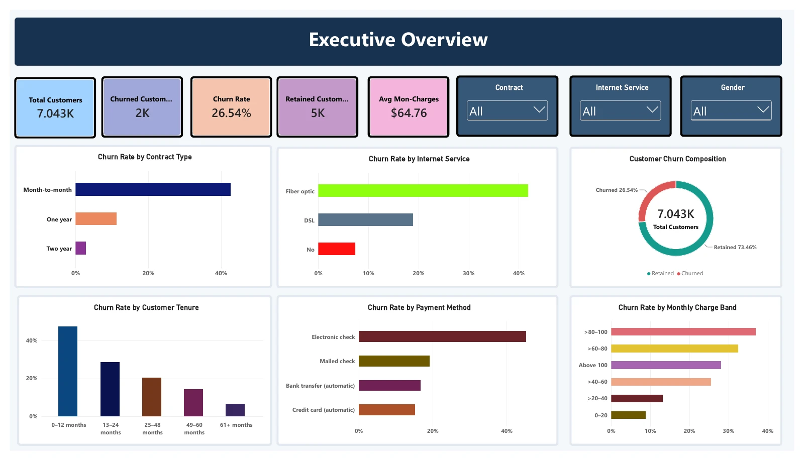

# Customer Churn and Retention Analytics

Which telecom customers should a retention team contact first? This Power BI project examines 7,043 customers across 1,129 cities. The clearest opportunity for a pilot was among first-year customers on month-to-month contracts. In that group, 51.35% left, compared with 26.54% across the full customer base.

[Read the project report (PDF)](assets/project-report.pdf) · [Explore the full dashboard (PDF)](assets/dashboard.pdf)

## Results at a glance

| Metric | Observed value |
| --- | ---: |
| Total customers | 7,043 |
| Customers who left | 1,869 (26.54%) |
| Customers retained | 5,174 (73.46%) |
| Average monthly charge | $64.76 |

## Findings and proposed action

- **Contract length.** Churn was 42.71% among month-to-month customers, 11.27% on one-year contracts and 2.83% on two-year contracts.
- **Technical support.** Among 5,517 internet customers, 41.64% of those without technical support left, compared with 15.17% of those with support. This observed gap provides a reason to test support outreach.
- **Retention pilot.** Offer a setup check and first-bill walkthrough to a randomly selected group of first-year month-to-month customers. Compare their 90-day churn rate with that of eligible customers receiving usual service.

## Explore the website

The **Dashboard** section contains ten expandable Power BI page exports covering the executive overview, demographics, geography, tenure, contracts and payments, support, streaming, customer value, churn reasons and retention planning. The **Project Report** section contains the 16-page written analysis.

The **Retention plan** calculator lets visitors adjust the assumed reduction in departures. For example, a 10% relative reduction saves an estimated 187 of the 1,869 customers who left. That leaves 1,682 departures among 7,043 customers, giving a hypothetical churn rate of **23.88%**.

## Run locally or publish

Download the repository, extract it and open `index.html` in a browser. The website uses HTML, CSS and JavaScript, with dashboard images and PDFs in the `assets/` folder.

To publish with GitHub Pages, keep `index.html`, `style.css`, `app.js` and `assets/` at the repository root. In **Settings → Pages**, select **Deploy from a branch**, choose **main** and **/(root)**, then save. After deployment, select **Visit site** to open the published website.

**Author:** Md Shoaib Akhtar
