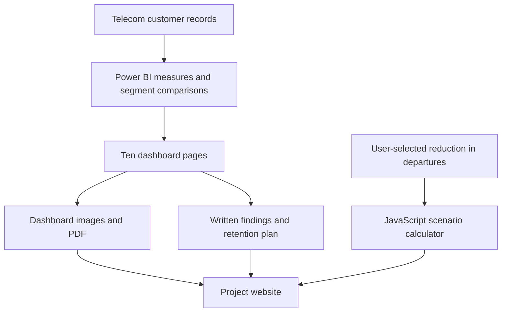
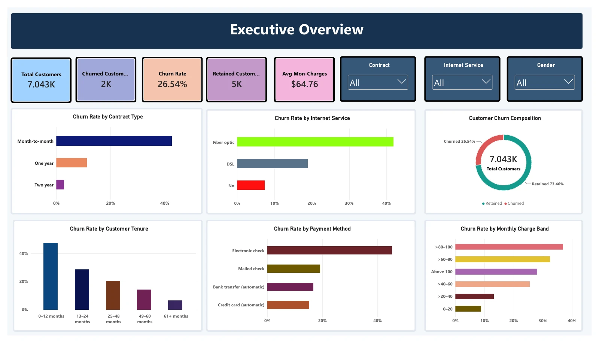

# 📊 Customer Churn and Retention Analytics

**A telecom customer retention study built with Power BI**

Of 7,043 customers, 1,869 left. Among first-year customers on month-to-month contracts, **51.35% left**, compared with **26.54% overall**. This project uses ten dashboard pages to investigate that gap and design a retention pilot.

[Read the 16-page project report](assets/project-report.pdf) · [View the complete dashboard](assets/dashboard.pdf)

---

## 📌 Project Overview

A retention team has to decide whom to contact and what help to offer. This analysis compares customer groups by tenure, contract, billing method and service experience. The accompanying website presents the original Power BI charts and an interactive calculator for exploring retention targets.

### 🎯 Project Objectives

- Measure churn and retention across the customer base.
- Identify groups with high churn rates and groups that account for many departures.
- Use reported cancellation reasons to propose specific actions and measures of success.

## 🚀 Key Features

- **Executive overview** with customer counts, churn rate, retention rate and average monthly charge.
- **Dashboard explorer** with ten expandable sections, each pairing a finding with its original chart page.
- **Written project report** with the methodology, dashboard walkthrough and recommendations.
- **Retention calculator** that converts a proposed percentage reduction in departures into customers saved and a revised churn rate.

## 📊 Dataset Overview

| Metric | Value |
| --- | ---: |
| Customers | 7,043 |
| Cities represented | 1,129 |
| Churned customers | 1,869 (26.54%) |
| Retained customers | 5,174 (73.46%) |
| Average monthly charge | $64.76 |
| Historical charges | $16.06 million |

## 📂 Dashboard Pages

| Page | Dashboard | Question explored |
| ---: | --- | --- |
| 1 | Executive Overview | How many customers left, and how does churn vary by segment? |
| 2 | Customer Demographics | How does churn differ by senior status, gender and household characteristics? |
| 3 | Geographic Churn Analysis | Which cities have the most departures, and how large are their customer bases? |
| 4 | Customer Lifecycle and Tenure | At which tenure stages is churn highest? |
| 5 | Contracts and Payment Behaviour | How does churn vary by payment method within each contract type? |
| 6 | Service Adoption and Support | How do outcomes differ for internet customers with and without technical support? |
| 7 | Streaming and Multiple Lines | Does the relationship between streaming and churn change across contracts? |
| 8 | Customer Value and Charges | How much had departing customers paid, and what were their monthly charges? |
| 9 | Churn Reasons and Score Analysis | Which reasons did customers give for leaving, and how were churn scores distributed? |
| 10 | Retention Plan | How would fewer departures change the overall churn rate? |

---

## 🔍 Key Business Insights

| Finding | Evidence |
| --- | --- |
| Early tenure and monthly contracts coincide with high churn | Among first-year customers, 51.35% on monthly contracts left, compared with 10.48% on one-year contracts. |
| Monthly contracts account for most departures | 42.71% of month-to-month customers left. Looking at all customers who left, 88.55% were on monthly contracts. |
| Technical support merits investigation | Among 5,517 internet customers, churn was 41.64% without support and 15.17% with support. Support staff attitude was the most frequently reported reason for leaving. |
| Departing customers paid higher monthly charges | Their monthly charge averaged $74.44, compared with $64.76 overall. Their accounts contributed $2.86 million in historical charges. |

## 💡 Business Recommendations

1. **Pilot first-year onboarding.** Offer a setup check and first-bill walkthrough to a randomly selected group of month-to-month customers. Compare 90-day churn with a group receiving usual service.
2. **Test a support callback.** Contact customers with unresolved issues. Track resolution, repeat contacts and subsequent cancellations.
3. **Review billing friction.** Electronic-check customers had 45.29% churn. Examine failed payments and billing queries before testing a change to the payment experience.

## 🏗️ System Architecture

## 🛠️ Technology Stack

| Technology | Project role |
| --- | --- |
| Power BI Desktop and DAX | Calculate measures, compare customer segments and build the dashboard pages |
| HTML and CSS | Present findings, chart exports and the downloadable report |
| JavaScript | Recalculate retention scenarios when a visitor moves the slider |
| GitHub Pages | Publish the static website from the repository |

## ⚙️ Methodology

1. **Reconcile the baseline.** Use the detailed customer matrix for exact counts. Overall churn equals 1,869 departures divided by 7,043 customers.
2. **Compare like groups.** Calculate each segment’s rate using its own customer count. For example, compare payment methods within the same contract type.
3. **Check the size of each group.** Acampo’s 75% churn represents three departures among four customers. One account changes that rate by 25 percentage points.
4. **Model a retention scenario.** A hypothetical 10% relative reduction in 1,869 departures gives 187 customers saved after rounding. The remaining 1,682 departures yield **23.88% scenario churn** on the original customer base.

## 📌 Challenges and Limitations

- The dashboard rounds some headline cards. Detailed tables provide the exact customer counts.
- The technical-support and streaming summaries cover 5,517 and 4,835 customers respectively. Each finding uses the population shown on its page.
- The export does not specify the observation period or how the churn score was calculated. The reported rates describe the observed customer base.

## 🔮 Future Scope

- Track monthly signup cohorts over equal follow-up periods.
- Validate churn scores on a later cohort before using them to prioritise outreach.
- Measure the cost per additional customer retained in the onboarding pilot.

---

## 📸 Dashboard Preview

## 🌐 Project Links and Setup

| Resource | Link |
| --- | --- |
| Written analysis and recommendations | [Project report (PDF)](assets/project-report.pdf) |
| All ten dashboard pages | [Power BI dashboard export (PDF)](assets/dashboard.pdf) |
| Website entry point | [index.html](index.html) |

**Local preview.** Download and extract the repository, then open `index.html` in a browser. The Power BI charts are exported images. The scenario calculator runs in the browser.

**GitHub Pages.** Keep `index.html`, `style.css`, `app.js` and the `assets/` folder at the repository root. Under **Settings → Pages**, choose **Deploy from a branch**, select **main** and **/(root)**, then save.

## 👨‍💻 Author

**Md Shoaib Akhtar** · Data Science & Analytics  
Mentor · Chandan Mishra

## 🏁 Conclusion

The first-year, month-to-month group offers a practical starting point for retention work. The dashboard identifies whom to contact, and a controlled onboarding pilot would show whether the proposed outreach helps more customers stay.
